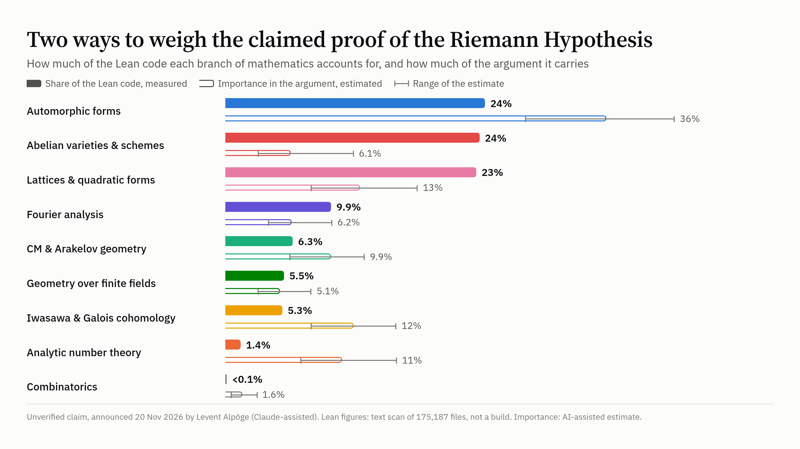
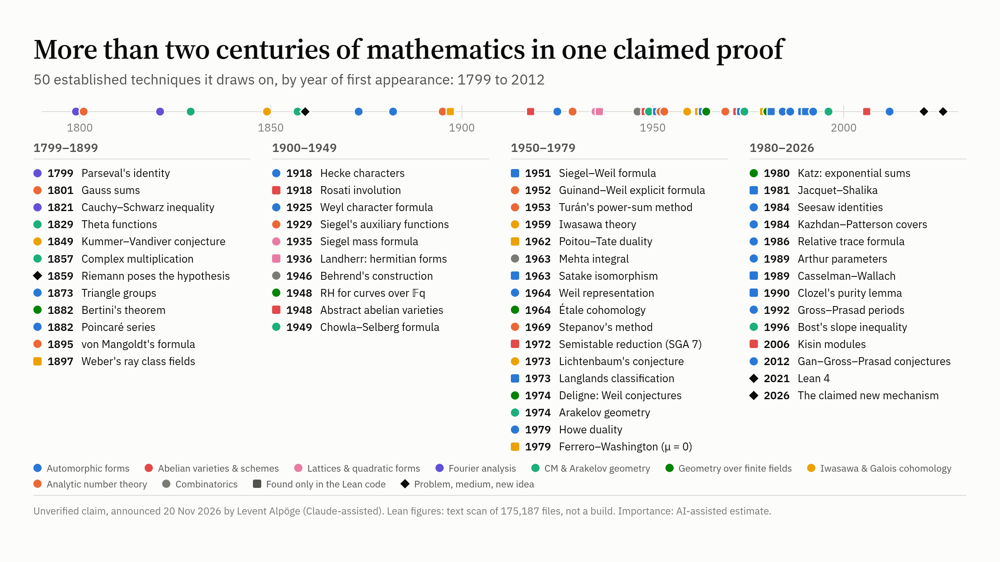

# RH proof anatomy

Which branches of mathematics does the claimed proof of the Riemann Hypothesis draw on, how much of each, and how old is each ingredient?

> **This maps a claim; it does not check it.** On 20 November 2026 Levent Alpöge announced a Claude-assisted proof of the Riemann Hypothesis, with a four-page note and a Lean 4 archive. Nobody outside has verified it yet. Everything here comes from reading the note and scanning the Lean code as text. Nothing was built, and a clean text scan is not a verification.

- **Interactive results:** [eyal-weiss.github.io/rh-proof-anatomy](https://eyal-weiss.github.io/rh-proof-anatomy/) (the same page as `rh_anatomy.html`)
- **Sources:** [the note](https://alpo.ge/remark.pdf) and the Lean archive at `https://alpo.ge/lean.tar.gz.part01` to `part14`. The archive is not redistributed here.



## Results at a glance

| Branch | Share of the Lean code (measured) | Importance, re-estimate (range) | Importance, first estimate |
|---|---|---|---|
| Automorphic forms & representation theory | 24.3% | 35.6% (28–42) | 35.2% |
| Abelian varieties, schemes & arithmetic geometry | 23.8% | 6.1% (3–12) | 0% |
| Quadratic forms, lattices & integral structures | 23.5% | 12.6% (8–18) | 8.3% |
| Fourier & harmonic analysis | 9.9% | 6.2% (4–10) | 6.4% |
| CM curves, periods & Arakelov geometry | 6.3% | 9.9% (6–13) | 12.6% |
| Algebraic geometry over finite fields | 5.5% | 5.1% (3–8) | 7.6% |
| Iwasawa theory, Galois cohomology & K-theory | 5.3% | 12.0% (8–16) | 10.5% |
| Analytic number theory | 1.4% | 10.9% (7–16) | 16.2% |
| Combinatorics & random matrix theory | <0.1% | 1.6% (0.5–3) | 3.1% |

- **The archive:** 175,187 Lean files, 15.5 million code lines, 818,755 theorem declarations, 234,220 definitions. With comments and strings removed, the text contains no `sorry`, `admit`, axiom declaration, `opaque`, `native_decide` or `implemented_by`. That is necessary for a complete proof, not sufficient.
- **The gap between the columns is the main finding.** Code share measures how much Lean each branch takes; importance estimates how much of the argument it carries. Foundations missing from Mathlib, such as abelian schemes and hermitian lattices, need a lot of code, while the decisive steps can be short.
- **Infrastructure:** 23% of the code's lines sit in small helper files with no branch-specific name (generic Mathlib vocabulary such as `Finset`, `Nat`, `Module`, `Ideal`, `Matrix`).
- **Timeline:** 50 established techniques, from Parseval (1799) to the Gan–Gross–Prasad conjectures (2012), median birth year about 1961. 36 are named or implied in the note and 14 more turn up only in the code. Of the note's 36, 12 are named in fewer than 10 Lean files; Stepanov, Vandiver, Lichtenbaum and Bost appear in none.
- **Classical theorems by name:** 1,070 files sit in folders called `PublishedTheorems`, named after results such as Jacquet–Shalika, Poitou–Tate, Ferrero–Washington, Casselman–Wallach, Kisin and Clozel's purity (about 5,000 theorem declarations). Names alone cannot show whether each is proved in full.



## What each number is

- **Share of the Lean code** is measured. Every `.lean` file is read as text; import lines and folder names inside qualified names are removed, because folder labels otherwise inflated some counts about sevenfold. 47 name patterns, each tied to one branch, are counted, and each pattern's count in a file is damped to log(1 + n). A file's code lines are split among branches in proportion to those damped counts. Files with no matching name take the branch mix of their folder.
- **Importance** is judgment. The first estimate weighs the 20 steps of the note's outline (2 for the three core steps, 0.5 for unclear or removable ones, 1 otherwise) and splits each step among branches. The re-estimate was made by Claude Fable 5.2 after reading the Lean findings, the note and 15 Lean files on the chain leading to the main theorem. Its brief and full answer are in [`notes/`](notes/).

The helper-file assumption barely matters. Four ways of handling it agree on the top three branches and on the near-absence of analytic number theory:

| Branch | Folder fill (shown) | Matched files only | Import fill | Folder-majority |
|---|---|---|---|---|
| Automorphic forms | 24.3% | 24.0% | 24.4% | 28.7% |
| Abelian varieties & schemes | 23.8% | 24.4% | 23.9% | 35.7% |
| Lattices & forms | 23.5% | 23.6% | 22.8% | 27.1% |
| Fourier analysis | 9.9% | 10.3% | 9.1% | 4.9% |
| CM & Arakelov | 6.3% | 6.4% | 6.2% | 0.7% |
| Geometry over 𝔽q | 5.5% | 5.0% | 5.9% | 1.0% |
| Iwasawa & Galois | 5.3% | 4.9% | 6.2% | 1.4% |
| Analytic number theory | 1.4% | 1.4% | 1.4% | 0.5% |
| Combinatorics | <0.1% | <0.1% | <0.1% | 0% |

"Import fill" gives each helper file the average mix of the files that import it (753,569 project import edges). "Folder-majority" gives each of the 793 folders wholly to its dominant branch; it is winner-take-all, so treat the middle branches as rough.

## Reproduce

Needs Python 3.8+ (standard library only) and about 2 GB of free disk. The images also need Google Chrome. Run from the repository root; timings are from an 8-core Linux machine.

```bash
python3 lean_census.py --download     # downloads the 14 parts, extracts lean_src/, writes census_out/ (~450 s, one process)
find lean_src/lean/src -type d -printf '%f\n' | sort -u > census_out/dirnames.txt
python3 branch_scan.py --procs 5 --per-file census_out/branch_perfile.jsonl   # 15–21 min on 5 processes
python3 weights.py                    # folder fill, matched-only, folder-majority, infrastructure view
python3 import_fill.py                # import fill (uses the per-file output)
python3 technique_hits.py --procs 5   # timeline counts (~76 s)
python3 folder_report.py census_out/branch_scan.json 40   # per-folder branch mix, for inspection
python3 social/make_cards.py          # images in social/ (reads the data in rh_anatomy.html)
```

`census_out/` already holds the outputs of a full run, so you can inspect results without downloading anything. The two large files are compressed: `gunzip -k census_out/files.csv.gz census_out/branch_perfile.jsonl.gz`.

## Files

| Path | What it is |
|---|---|
| `rh_anatomy.html` | The interactive page: branch chart, archive facts, timeline, outline steps, caveats |
| `lean_census.py` | Downloads and extracts the archive; per-file census, trust-signal counts, `census_out/digest.md` |
| `branch_scan.py` | Branch shares from name patterns; `--per-file` also writes each file's split and imports |
| `weights.py`, `import_fill.py` | The four ways of handling helper files; write `census_out/measured_weights.json` |
| `technique_hits.py` | How many Lean files name each timeline technique |
| `folder_report.py` | Per-folder branch mix and top patterns |
| `make_artifact.py` | Strips the page into the form the Claude artifact host expects |
| `social/` | Images for posts and the script that builds them |
| `census_out/` | Measured outputs: `digest.md`, `census.json`, `files.csv.gz` (one row per file), `branch_scan.json`, `branch_perfile.jsonl.gz`, `measured_weights.json`, `technique_hits.json`, `dirnames.txt` |
| `notes/` | Analysis notes, the brief and answer of the importance re-estimate, and a survey of existing Lean analysis tools |

## Caveats

- Code share measures formalization volume, not importance.
- Name patterns are judgment calls. Some names are ambiguous (Mathlib's `Lattice` is an order lattice; `IsTheta` is an asymptotic bound), and a technique can be formalized under names no pattern catches.
- Every file is reachable by imports from the main theorem, so the scan cannot tell which code the final proof actually depends on. That needs a build and a declaration-level dependency trace, plus `#print axioms` and an independent kernel check.
- The importance re-estimate matched Lean statements to outline steps by their shape, since many names are opaque, and could not tell whether outline steps 3 to 7 survive in the final formal argument.
- Years mark the first appearance of an idea; most tools kept developing for decades.

## Credits and license

Made with Claude Code. The importance re-estimate is by Claude Fable 5.2. The note and the Lean archive belong to their author and are not included here.

Code is under the MIT license (`LICENSE`). Text, charts and data are under [CC BY 4.0](https://creativecommons.org/licenses/by/4.0/).
